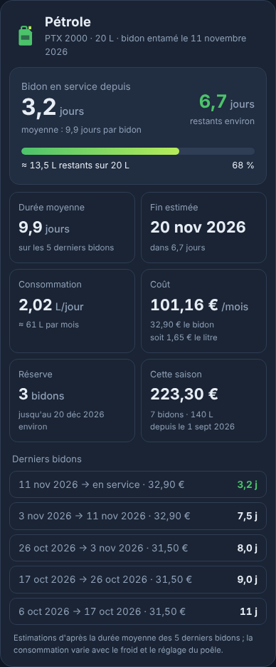

<p>
  ☕ <strong>Si cette carte vous est utile, vous pouvez soutenir le projet :</strong>
</p>

<div style="white-space: nowrap; line-height: 0;">
  <a
    href="https://www.buymeacoffee.com/Marlboro62"
    target="_blank"
    rel="noopener noreferrer"
    style="display: inline-block; text-decoration: none; vertical-align: middle;"
  ></a>&nbsp;&nbsp;<a
    href="https://ko-fi.com/M4M2QL45X"
    target="_blank"
    rel="noopener noreferrer"
    style="display: inline-block; text-decoration: none; vertical-align: middle;"
  ></a>
</div>

# Pétrole

Carte Lovelace pour Home Assistant qui suit le pétrole d'un poêle (combustible liquide en bidons,
type PTX) : bidon en service, pétrole restant estimé, durée moyenne d'un bidon, fin estimée,
consommation, coût, réserve de bidons et dépense de la saison de chauffe.

À chaque bidon entamé, on bipe le tag NFC collé sur le poêle avec son téléphone. Le bidon est noté
dans le calendrier, un bidon est retiré de la réserve, et la carte fait le reste.

Les bidons s'achètent au gré des prix et des magasins : le bouton **« + Achat »** de la carte note
chaque achat (nombre de bidons, prix par bidon, magasin, date) et remonte la réserve. Chaque bidon
entamé reprend le prix et le magasin de son achat, les plus anciens d'abord.



**[Voir la démo en ligne](https://marlboro62.github.io/petrole-card/docs/demo.html)** (bidons simulés).

## Ce que contient le dépôt

| Fichier | Rôle |
| --- | --- |
| `petrole-card.js` | la carte `custom:petrole-card`, qui peut installer le tag NFC depuis son éditeur |
| `packages/petrole.yaml` | les mêmes entrées et la même automatisation du tag, en YAML (package Home Assistant) |
| `docs/demo.html` | la démo, avec des bidons fictifs |

## Installation de la carte

Dans **Paramètres › Marketplace** (ou HACS avant la 2026.11), ajoutez ce dépôt comme dépôt
personnalisé de type **Tableau de bord** : `https://github.com/Marlboro62/petrole-card`,
installez **Pétrole**, puis rechargez la page (Ctrl+F5).

Installation manuelle : copiez `petrole-card.js` dans `/config/www/` et ajoutez la ressource
`/local/petrole-card.js` (type module) dans **Paramètres › Tableaux de bord › Ressources**.

## Installation du tag NFC depuis la carte (recommandé)

Sans fichier à copier ni redémarrage, avec un compte administrateur :

1. Créez un calendrier local (**Paramètres › Appareils et services › Ajouter une intégration ›
   Calendrier local**) ou gardez le vôtre.
2. Ajoutez la carte à un tableau de bord et ouvrez son éditeur. Choisissez le calendrier.
3. Sous les options de la carte, dans **Installation du tag NFC**, renseignez :
   - le **tag du poêle**, choisi dans la liste de vos tags (un tag dont le nom parle de pétrole est
     proposé tout seul ; un ID inconnu de Home Assistant est signalé) ;
   - la **contenance** d'un bidon (20 L) et son **prix** ;
   - le **suivi de la réserve** de bidons (activé par défaut) ;
   - le **téléphone par défaut** (facultatif : c'est d'abord le téléphone qui a bipé qui est prévenu).
4. Touchez **Installer ou mettre à jour**. La carte crée :
   - l'entrée `input_number.petrole_prix_du_bidon` (à changer quand le prix change) ;
   - l'entrée `input_number.petrole_bidons_en_reserve` (à remonter quand vous achetez des bidons) ;
   - l'automatisation **« Bidon de pétrole entamé (tag NFC) »**.
5. Si le tag n'existe pas encore, écrivez-le avec l'application compagnon (**Paramètres › Tags ›
   Ajouter un tag**), collez-le sur le poêle ou sur l'étagère des bidons, puis relancez l'installation
   en le choisissant dans la liste. L'automatisation se déclenche sur l'**ID** du tag.

Relancer l'installation ne perd rien : les bidons déjà notés restent dans le calendrier, et la
réserve garde sa valeur. Un second bip dans les 10 minutes est ignoré (double lecture du tag).

## Installation en YAML

Pour tout écrire à la main, copiez [`packages/petrole.yaml`](packages/petrole.yaml) dans
`/config/packages/` (les packages doivent être chargés par `configuration.yaml`), adaptez les
lignes marquées « À ADAPTER », vérifiez la configuration puis redémarrez.

## La carte

```yaml
type: custom:petrole-card
calendar: calendar.home
label: PTX 2000 · 20 L
```

| Option | Défaut | Rôle |
| --- | --- | --- |
| `calendar` | `calendar.home` | calendrier où chaque bidon est noté |
| `summary` | `Bidon pétrole` | titre des événements des bidons entamés |
| `purchase_summary` | `Achat pétrole` | titre des événements des achats |
| `purchases` | `3` | derniers achats listés |
| `title` | `Pétrole` | titre de la carte |
| `label` | — | texte sous le titre (le combustible, par exemple) |
| `capacity` | `20` | contenance d'un bidon en litres, si l'événement ne la donne pas (nombre ou entité) |
| `price` | `input_number.petrole_prix_du_bidon` | prix d'un bidon, si l'événement ne le donne pas (nombre ou entité) |
| `stock` | `input_number.petrole_bidons_en_reserve` | réserve de bidons (entité ou nombre) ; `""` pour ne pas l'afficher |
| `average_over` | `5` | durée moyenne calculée sur les derniers bidons terminés |
| `season_start` | `9` | mois de début de la saison de chauffe (septembre) |
| `history` | `5` | derniers bidons listés |
| `warn_days` | `3` | alerte « bientôt vide » quand il reste moins de ce nombre de jours |
| `theme` | `v2` | `v2` (bleu nuit), `auto` (clair si Home Assistant est en mode clair) ou `ha` (thème Home Assistant) |
| `font_size` | `100` | taille du texte, en % |

Toutes ces options sont aussi dans l'éditeur visuel.

### Ce que la carte affiche

- **Bidon en service** : depuis combien de jours, jours restants estimés et jauge du pétrole restant.
- **Durée moyenne** d'un bidon, sur les derniers bidons : la consommation change avec le froid, la
  moyenne suit donc la saison.
- **Fin estimée** du bidon en service.
- **Consommation** en litres par jour et par mois.
- **Coût** par mois, prix du bidon et prix au litre.
- **Réserve** : bidons d'avance, et jusqu'à quand ils devraient durer. La tuile passe en rouge
  quand il reste un bidon ou moins.
- **Cette saison** : bidons, litres et dépense depuis le début de la saison de chauffe.
- **Derniers bidons**, avec leur durée, leur prix et leur magasin.
- **Derniers achats**, prix moyen d'un bidon et magasin le moins cher.

Les estimations apparaissent à partir du deuxième bidon : il faut un bidon terminé pour connaître
sa durée.

### Noter un achat

Touchez **« + Achat »** en haut de la carte :

- **Bidons achetés** et **prix par bidon** (le prix du dernier achat est proposé) ;
- **magasin** (les magasins déjà notés sont proposés) ;
- **date de l'achat** (aujourd'hui par défaut ; un achat passé peut être noté après coup) ;
- **réserve après l'achat** : calculée (réserve actuelle + bidons achetés), à corriger si besoin.
  La réserve compte les bidons pleins d'avance, pas celui en service.

« Noter l'achat » ajoute un événement « Achat pétrole » au calendrier, met la réserve à jour et
garde le prix pour le prochain bip. Pas besoin d'être administrateur.

La section **Derniers achats** liste les achats, avec le prix moyen d'un bidon sur un an et le
magasin le moins cher en moyenne.

### Format des événements

L'automatisation note chaque bidon dans le calendrier :

- titre : `Bidon pétrole` ;
- description : `20 L · 32.9 €` (contenance, puis prix s'il est renseigné).

Chaque achat noté par « + Achat » :

- titre : `Achat pétrole` ;
- description : `3 × 35.95 € · Auchan` (nombre de bidons, prix par bidon, magasin).

Un bidon ajouté à la main dans le calendrier, avec le même titre, compte aussi. Sans contenance ni
prix dans la description, la carte prend les options `capacity` et `price`.

## Support

Les questions et les problèmes passent par les
[issues GitHub](https://github.com/Marlboro62/petrole-card/issues).

## Licence

[MIT](LICENSE)
